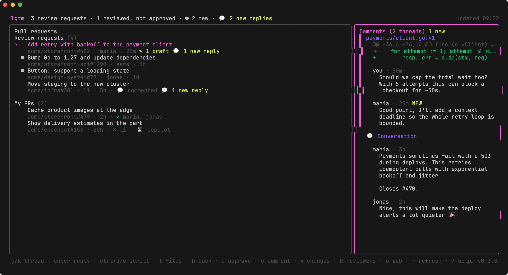
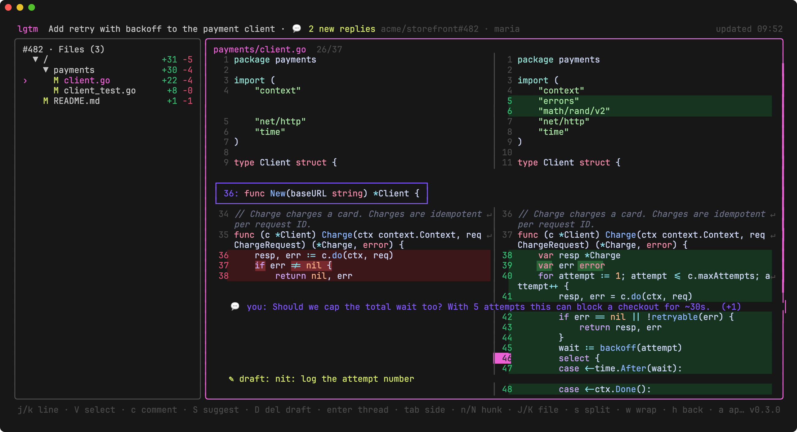

# lgtm

A terminal UI for GitHub pull request reviews. Get notified when someone requests your review, read the diff with vim keys, comment on lines, and approve, comment or request changes without leaving the terminal.

Works on macOS, Linux and Windows.





## Install

lgtm uses the [GitHub CLI](https://cli.github.com) for everything, so install it and log in first:

```sh
gh auth login
```

Then install lgtm:

| Platform | Command |
| --- | --- |
| macOS / Linux (Homebrew) | `brew install dennishammarstrand/tap/lgtm` |
| Windows (Scoop) | `scoop bucket add dennishammarstrand https://github.com/dennishammarstrand/scoop-bucket` then `scoop install lgtm` |
| Debian / Ubuntu, Fedora | download the `.deb` or `.rpm` from [Releases](https://github.com/dennishammarstrand/lgtm/releases) |
| Anything with Go | `go install github.com/dennishammarstrand/lgtm@latest` |

### Binary releases

For Windows, macOS or Linux, you can download a binary release [here](https://github.com/dennishammarstrand/lgtm/releases/latest). Unpack the archive and put `lgtm` (`lgtm.exe` on Windows) somewhere on your `PATH`.

### Updating

lgtm checks for a new release once a day and shows `↑ v0.2.0 available` in the header when there is one. Press `U` to update: lgtm asks first, then runs `brew upgrade lgtm` or `go install …@latest` and restarts itself. Scoop can't update a running app, so on Windows it tells you to quit and run `scoop update lgtm`; for a downloaded binary it opens the release page. Or update with the tool you installed it with:

| Installed with | Update with |
| --- | --- |
| Homebrew | `brew upgrade lgtm` |
| Scoop | `scoop update lgtm` |
| Go | `go install github.com/dennishammarstrand/lgtm@latest` |
| `.deb` / `.rpm` / binary | download the new release |

## Usage

```sh
lgtm                      # TUI, checks for changes every minute
lgtm -interval 2m         # check less often (GitHub sets the minimum, usually 60s)
lgtm -query "--review-requested=@me --owner=my-org"
lgtm -mine=false          # hide your own PRs
lgtm -notify=false        # no desktop notifications
lgtm -theme dracula       # syntax theme for diffs, see Configuration
lgtm check                # poll once, notify, exit (for a scheduler)
lgtm -version
```

Use a terminal with true colour and a font with box-drawing characters (most modern terminals, including Windows Terminal).

## Configuration

To change the defaults without passing flags every time, create `~/.config/lgtm/config.yml` (`$XDG_CONFIG_HOME/lgtm/config.yml` if set, `%APPDATA%\lgtm\config.yml` on Windows, or any path in `$LGTM_CONFIG`). Every setting is optional; these are the defaults:

```yaml
notifications: true             # desktop notifications for review requests and replies
interval: 1m                    # how often to check for changes
query: "--review-requested=@me" # extra `gh search prs` flags selecting the PRs to watch
mine: true                      # also list your own open PRs
theme: catppuccin-mocha         # syntax theme for diffs
```

Flags override the file. `lgtm check` uses it too, and `lgtm -help` shows where lgtm looks for it.

`theme` colours the code in diffs; the rest of the UI follows your terminal's colours. Any [Chroma style](https://xyproto.github.io/splash/docs/) works (that page previews them all), for example `dracula`, `github-dark`, `nord`, `gruvbox`, `tokyonight-night` or, for light terminals, `catppuccin-latte` and `github`. An unknown name lists the valid ones.

## Layout and keys

Two screens of two panes: **PRs | Comments**, then **Files | Diff**. `l` goes PRs → Comments → Files → Diff, `h` goes back. The files column is a tree. Selecting a directory shows the diff of every file under it in one scrollable view; the top row covers the whole PR. `l` goes one level deeper and `h` goes back. `j`/`k` always move within the focused column.

| Key | Action |
| --- | --- |
| `j` / `k` | down / up (moves the line cursor in the diff) |
| `l` / `enter` | go deeper; in the diff with wrap off, pan right |
| `h` / `esc` | go back; in the diff, `h` pans left first, then goes back |
| `gg` / `G`, `ctrl+d` / `ctrl+u` | top / bottom, half page |
| `space` | fold / unfold a directory in the file tree |
| `J` / `K` | next / previous file while in the diff; in the file tree, scroll the diff |
| `n` / `N` | next / previous hunk |
| `s` | toggle side-by-side / unified diff (remembered between runs) |
| `w` | toggle line wrapping (remembered); with wrap off, `h`/`l` pan |
| `enter` | in Comments: reply to the selected thread (inline threads get a threaded reply, the PR conversation a new comment) |
| `V` | in the diff: select lines (stays within one hunk, like GitHub); `esc` cancels |
| `c` / `i` | in the diff: comment on the cursor line or selection. `ctrl+s` adds it to your draft review, `ctrl+o` posts it right away. On a line with a draft it edits the draft |
| `S` | in the diff: suggest a change (pre-filled GitHub suggestion block) |
| `D` | in the diff: delete the draft comment on the cursor line |
| `tab` | in side-by-side: comment on the old or the new side |
| `a` / `c` / `x` | approve / comment / request changes (`ctrl+s` submits). With a selection they act on all selected PRs at once; any that fail stay selected for a retry |
| `space` / `*` | in the PR list: select a PR / every review request with the same title (e.g. one change across many repos); `esc` clears |
| `R` | request reviewers: suggestions, or search people/teams; `tab` selects, `ctrl+s` requests. Re-requests reviewers who already reviewed; `Copilot` requests a Copilot review. With a selection it requests the chosen reviewers on every selected PR (suggestions and search cover all their repos) |
| `o` | open in browser |
| `U` | update lgtm when a new version is available (asks first) |
| `r` | refresh |
| `?` | help |
| `q` | quit |

`●` marks PRs you haven't opened yet.

The list has two sections: **Review requests** and **My PRs** (your open PRs). Each of your PRs shows its reviewers: ✓ approved, ✗ changes requested, 💬 commented, ⏳ waiting. Only review requests trigger notifications.

The Comments pane shows the selected PR's inline review threads (with a few lines of diff context) and its conversation (comments and review messages, without bot noise). The thread with the most recent comment comes first. A **reply** is a comment by someone else after your first comment in a thread. New replies are marked `NEW`, counted in the PR list and header (`💬 2 new replies`), and trigger a notification, also from `lgtm check`. Opening a PR's comments marks its replies read.

## Inline review

In the diff, `j`/`k` move a line cursor. `V` selects lines, and `c` comments on them. Comments go into a **draft review**: drafts are kept locally (they survive a restart), show as `✎` notes under their lines and as `✎ N drafts` in the PR list. `a`/`x` (or `c` from the other panes) submit the review with all drafts in one go. Existing review threads show as `💬` notes under their lines; `enter` opens the thread in the Comments pane to read and reply.

Diffs are syntax highlighted, and within a changed line the exact words that changed get a stronger background.

GitHub removes the review request as soon as you submit any review, including a comment. lgtm keeps such PRs in the list, marked `💬 commented` or `✗ changes requested`, until you approve them or they are merged or closed. If the author removes you as a reviewer before you've reviewed, the PR is dropped.

## Notifications

lgtm watches your GitHub notifications with a conditional request (`If-None-Match`). An unchanged answer (`304`) is free: it doesn't count against your rate limit. lgtm only runs the full PR search when a notification arrives. It also does a full refresh every 10 minutes, because a removed review request or a merged PR doesn't always create a notification. GitHub's `X-Poll-Interval` (normally 60s) sets the minimum interval.

Desktop notifications use Notification Center on macOS (install `terminal-notifier` to open the PR by clicking the notification), the desktop notification service on Linux, and toasts on Windows.

lgtm notifies while it's running. To get notified when it's closed, run `lgtm check` from a scheduler such as launchd, systemd or Task Scheduler: it polls once and exits. Both share the same state, so each request is only notified once. The very first run records the existing requests without notifying. State lives in `$XDG_STATE_HOME/lgtm` (default `~/.local/state/lgtm`), or `%LOCALAPPDATA%\lgtm` on Windows.

## Building from source

```sh
make install              # builds into ~/.local/bin (override with BIN_DIR=...)
make test
make screenshots          # regenerate the README screenshots from demo data
```

Releases are built by [GoReleaser](https://goreleaser.com) when a `v*` tag is pushed.
